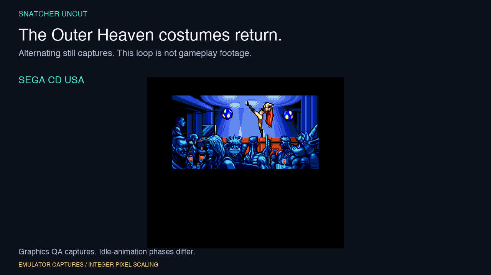
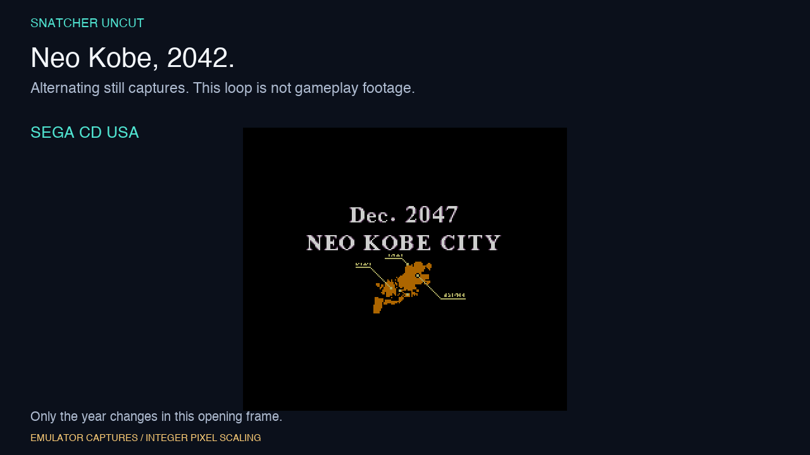
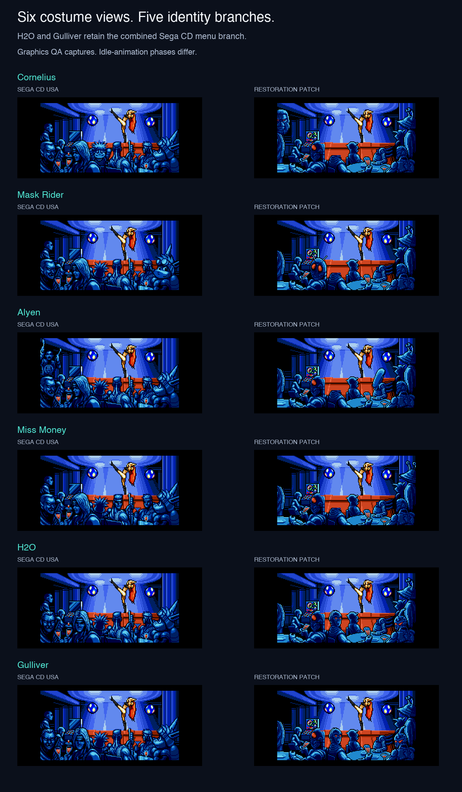
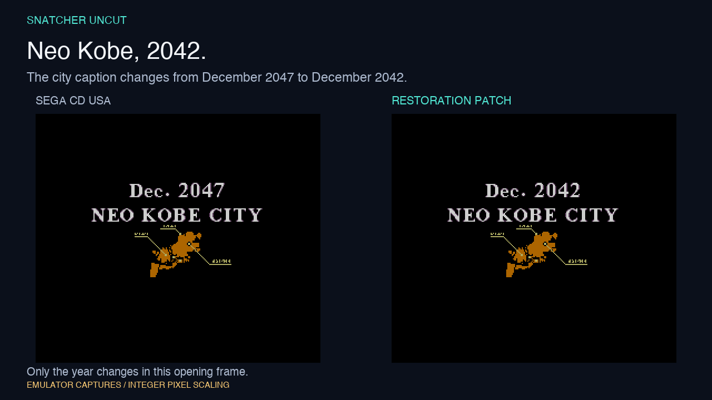
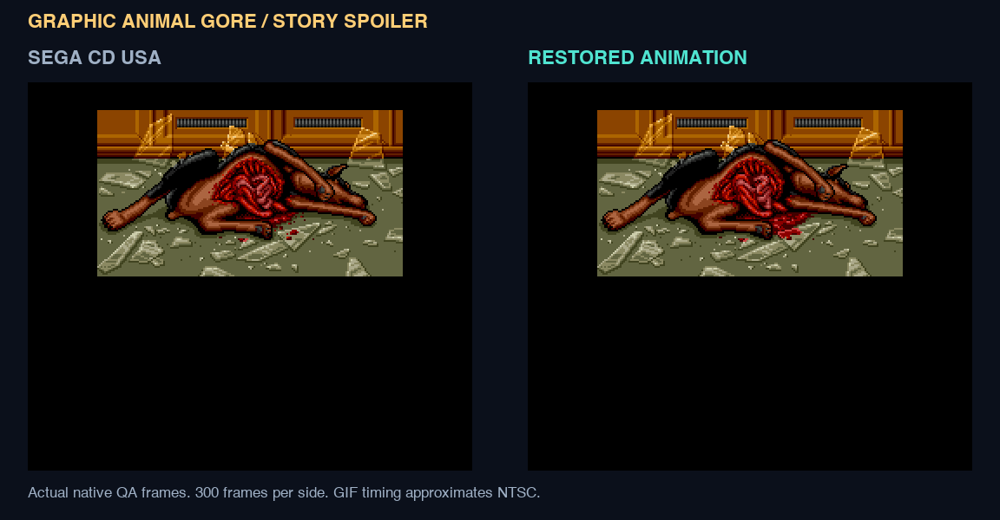

  

<h1 align="center">Restore the cameos. Keep the English dub.</h1>

  Play Snatcher's English Sega CD release with selected artwork and dates restored. 
  The original voice cast, music and expanded Act 3 stay. 
  Patch locally in your browser.

  <a href="https://github.com/t3chnaztea/snatcher-uncut-segacd/releases/download/v0.9.0-rc1/snatcher-uncut-player-v0.9.0-rc1.zip"><strong>Download the player patch</strong></a> 
  Free · v0.9.0-rc1 · 691,239 bytes · Supply your own USA disc dump  
  <a href="#see-the-changes">See the changes</a> · <a href="https://github.com/t3chnaztea/snatcher-uncut-segacd/releases/download/v0.9.0-rc1/snatcher-uncut-media-v0.9.0-rc1.zip">Download the comparison kit</a>

## See the changes

### The Outer Heaven patrons return

The costume patrons from the PC Engine version replace the Sega CD's Konami cameos. Their descriptions change with them. The original dancer and lighting remain. These are patron crops from actual emulator graphics checks.

<table>
<tr>
<td width="50%"></td>
<td width="50%"></td>
</tr>
<tr>
<td>Outer Heaven: original and restored stills.</td>
<td>Neo Kobe: 2047 becomes 2042.</td>
</tr>
</table>

Both six-second GIFs alternate captured stills. They are comparisons, not gameplay video. The source pixels use integer scaling.

### Six restored costume views

These graphics-check captures use different idle-animation phases. Six costume views share the existing five identity groups; H2O and Gulliver keep their combined menu branch.

### The dates change on screen

Neo Kobe returns to 2042. The newspaper dates change to 2039. The catastrophe caption changes to 1991. [Compare Moscow](media/assets/moscow-comparison.png) and [the newspaper](media/assets/newspaper-comparison.png).

### Watch the 42-second comparison

[Play the MP4](media/assets/release-reel.mp4) · [WebM version](media/assets/release-reel.webm). The reel is a silent edit of actual comparison stills.

Optional animation comparison: graphic animal gore and story spoiler

The dog scene animates again. This five-second clip compares native emulator samples. The source selection stays static here; the restored sequence moves.

The patch also restores an adult corpse pose. Neither scene appears in the lead images or reel.

## Patch your copy in three steps

1. [Download the player ZIP](https://github.com/t3chnaztea/snatcher-uncut-segacd/releases/download/v0.9.0-rc1/snatcher-uncut-player-v0.9.0-rc1.zip). Extract the whole folder.
2. Open `browser/index.html`. Choose your original single BIN and CUE. Select **Verify and patch**.
3. Save the patched BIN and CUE together in a new folder. Open that CUE in your player.

Patching runs locally. Your disc files stay on your computer. The installer verifies the data track before and after patching. It preserves your audio bytes and disc timing. The download contains no game or BIOS.

[Full instructions and supported inputs](INSTALL.md) · [Offline route for split-track sets](OFFLINE-INSTALL.md). Keep your originals. Back up saves before patching. Windows, Linux and mobile operation remain untested.

## Tested through the ending

Automated Genesis Plus GX testing reached the ending and original credits. Required fights, transitions, normal saving, shutdown and a fresh game-menu load passed. All 20 reference audio tracks and pregaps stayed byte-identical. The accepted route spans several sessions, including an Act 2 emulator checkpoint; it is not one uninterrupted cold playthrough.

Original-console acceptance remains pending. [Verification and installer checks](VERIFICATION.md) · [Compatibility and known issues](KNOWN-ISSUES.md).

## Before you download

**How much is "Uncut"?** Selected restorations: 31 text records and six art records, not 37 separate scenes. Those cover chronology, cameo identities, three opening captions and the visual changes above. Adult ages stay at 18. Optional menus and excluded age or sexualized-minor content stay unchanged. [Exact change list](CHANGELOG.md).

**Does it replace the English script or voices?** Most of the existing localization stays. Selected dates and cameo wording change. The opening and database show 1991 while the retained speech says 1996. No voices or music were re-recorded.

**Was AI used?** Yes. TECH NASTY developed this patch with AI coding agents for research, code, test controllers, evidence review and documentation. The art comes from source game data through deterministic conversion. The images are emulator captures. No generative image model made the game art. Automated review is not independent human QA. [Process disclosure](AI-DISCLOSURE.md).

This is an unofficial fan patch with no Konami affiliation. [Credits and references](CREDITS.md) · [Rebuild from source](docs/setup.md) · [Report a bug](https://github.com/t3chnaztea/snatcher-uncut-segacd/issues).
