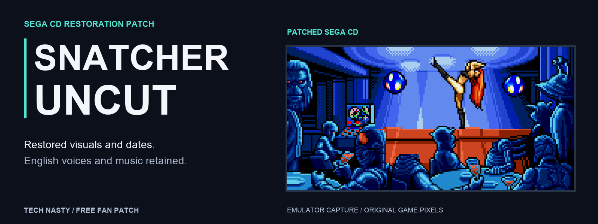
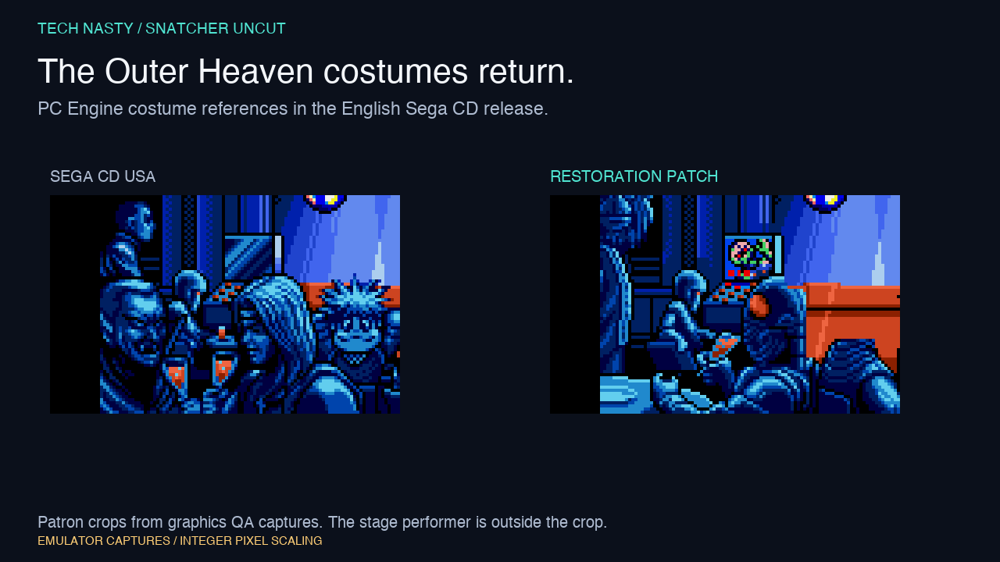
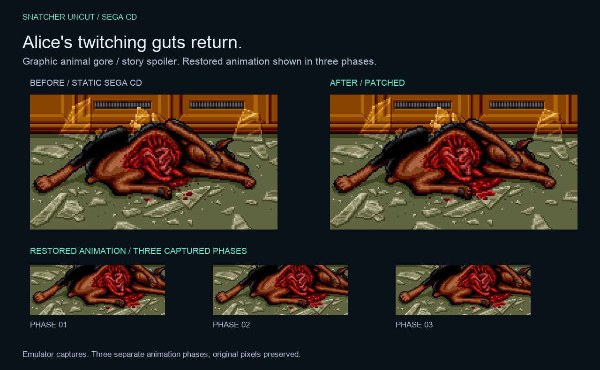
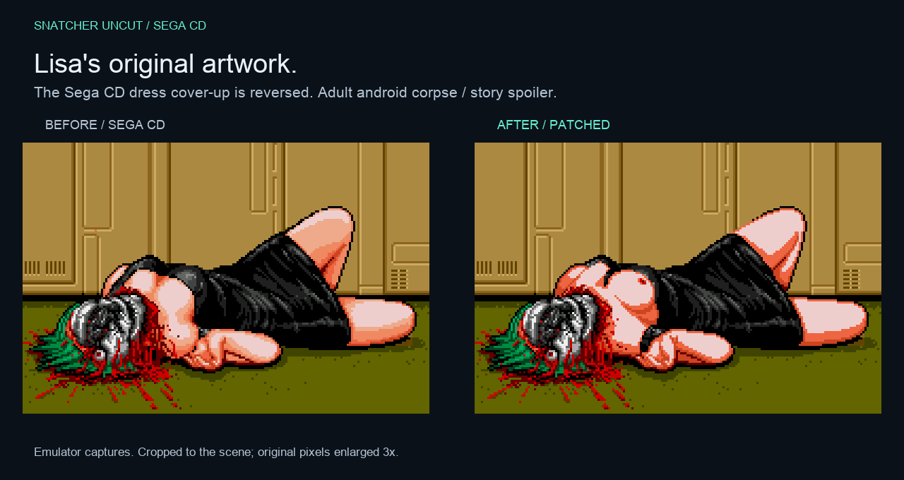
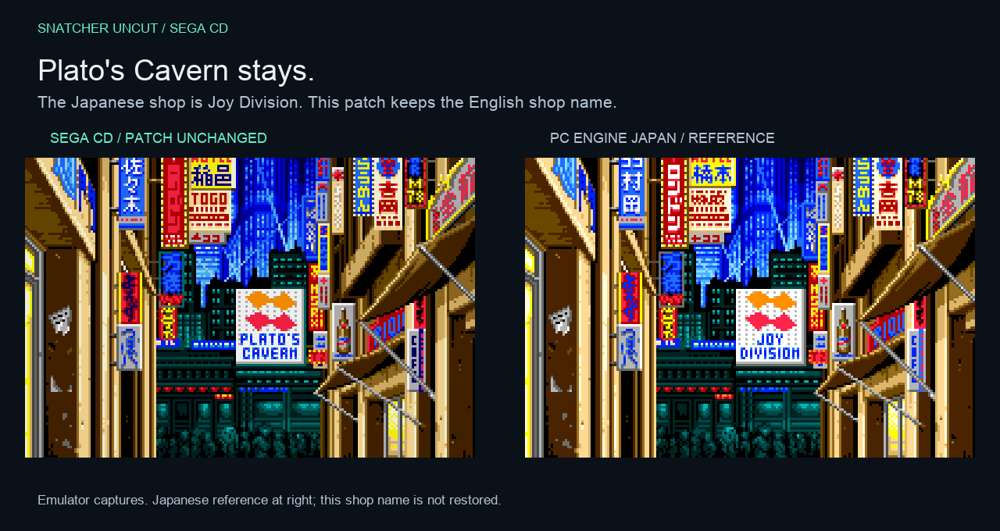
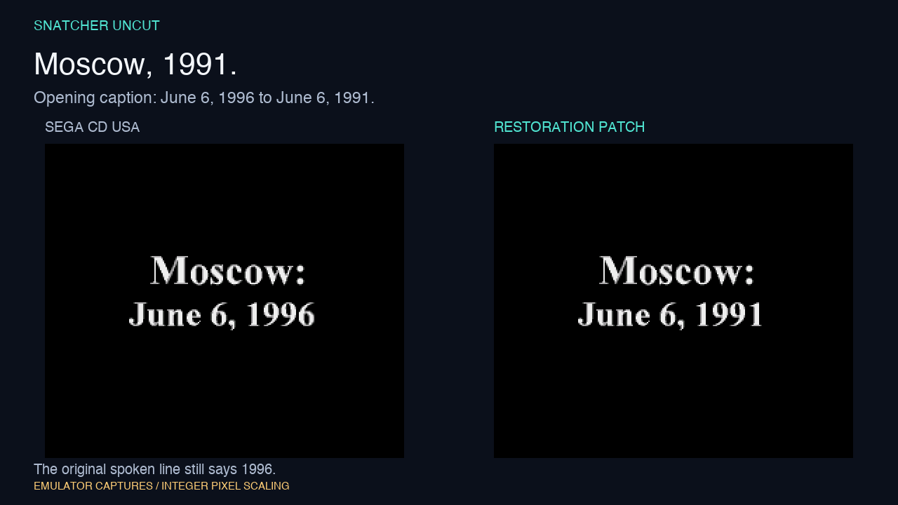

  

<h1 align="center">Snatcher for Sega CD, mostly uncensored</h1>

  A partial restoration of the English Sega CD release. 
  Unofficial fan patch. Includes browser-based patch tool.

Choose what to restore with **Snatcher Patcher**. Keep the original Sega CD dates to match the English voices, or use the Japanese chronology. Cameos, Alice and Lisa each have their own switch. The default keeps every restoration from the earlier release.

## RESTORED

- Dog guts: Alice's twitching intestines return, restoring the PC Engine animation.
- Lisa's dress: Her android corpse's exposed breast returns, reversing the Sega CD cover-up.
- Outer Heaven cameos: The six original film/TV costume views return, with matching dialogue and headings.
- Dates: Selected text and opening captions can use the Japanese chronology: 1991, 2039 and 2042. Choose **Original Sega CD dates** to keep 1996, 2044 and 2047.

## UNCHANGED

- English voices and music: Original recordings stay intact. Choose the original dates to match the voices. Japanese dates retain the spoken 1996 / on-screen 1991 difference.
- Expanded Act 3: Sega CD's story additions stay.
- Shower scene and panty-sniffing: No restoration. Sexualized content involving the Japanese version's underage character is outside this patch's scope. The English ages stay 18.
- Other dialogue and optional menus: Most of the localization stays. Rebuilding omitted interactions and translating their dialogue is outside this release's scope.

  <a href="https://github.com/t3chnaztea/snatcher-uncut-segacd/releases/download/v0.10.0-rc1/snatcher-uncut-player-v0.10.0-rc1.zip"><strong>Download the player patch</strong></a> 
  Free · v0.10.0-rc1 · Four restoration controls · You'll need your own USA disc dump 
  The default restoration worked on my U.S. Genesis Model 2 with a Mega EverDrive Pro. Other combinations have not been tested on the console.  
  <a href="#see-the-changes">See the changes</a> · <a href="https://github.com/t3chnaztea/snatcher-uncut-segacd/releases/download/v0.9.0-rc1/snatcher-uncut-media-v0.9.0-rc1.zip">Download the comparison kit</a>

## See the changes

### The Outer Heaven patrons return

The PC Engine costume cameos replace the Konami characters in the Sega CD bar. Their descriptions change too. The dancer and lighting stay as they were.

### Six restored costume views

The characters were captured at different points in their idle animations.

### Choose which dates appear on screen

With Japanese dates selected, Neo Kobe returns to 2042. The opening captions and selected database dates change together. Original Sega CD dates keep 2047.

## NSFW

Show Alice and Lisa comparisons: graphic gore, nudity and story spoilers

### Alice the dog's twitching guts

The Sega CD scene is static. The patch restores the animation. The three close-ups show different phases as separate stills.

### Lisa Nielsen's android corpse

The original exposed breast returns. The surrounding scene stays intact.

## Misc

### Joy Division / Plato's Cavern: unchanged

The Japanese shop is Joy Division. This patch keeps Plato's Cavern because the English dialogue still uses that name. Changing only the sign would make them disagree. This comparison records the difference; it is not a restored change.

### Moscow: 1996 → 1991

Japanese dates return the caption to 1991. The retained English voice recording still says 1996. Choose original Sega CD dates to keep both at 1996.

### Newspaper: 2044 → 2039

Japanese dates return both newspaper date elements to 2039. Original Sega CD dates keep 2044.

Game comparisons use actual emulator captures from graphics QA. Crops remove empty borders and enlarge the original pixels by whole numbers. No game artwork is generated or retouched.

## Snatcher Patcher

1. [Download the player ZIP](https://github.com/t3chnaztea/snatcher-uncut-segacd/releases/download/v0.10.0-rc1/snatcher-uncut-player-v0.10.0-rc1.zip). Extract the entire folder.
2. Open `browser/index.html` in your browser.
3. Under **01 · Restoration settings**, select the dates, cameos, Alice animation and Lisa artwork you want.
4. Under **02 · Original disc BIN**, choose your untouched USA BIN. Under **03 · Matching CUE**, choose the CUE from the same dump.
5. Under **04 · Verify, then restore**, select **Verify and patch**. Wait for **Your patched files are ready**.
6. Download the patched BIN, CUE and verification receipt. Save them in a new folder. Open the CUE in your emulator or compatible player.

Related changes stay together. Cameo artwork and dialogue use one switch. Alice's animation includes its required timing changes. There are 16 selections: 15 patched outputs and one original-disc selection. If you choose original dates and turn off all three art switches, no patch or download is needed.

Your files stay on your computer. Snatcher Patcher verifies the original and selected data-track checksums. Your audio and disc timing stay intact. Output filenames and the receipt identify your settings. Changing a setting clears the old downloads. No game or BIOS is included.

[Full instructions](INSTALL.md) · [Offline installer for split-track sets](OFFLINE-INSTALL.md). Keep your originals and back up your saves. Windows, Linux and mobile installation have not been tested.

## Testing

The default build is byte-identical to the earlier accepted release. Automated Genesis Plus GX tests reached the ending and credits. They covered required fights, transitions and a normal save followed by shutdown, fresh boot and loading from the game menu. Act 1 started from cold boot; the later tests continued from an Act 2 checkpoint. All 20 audio tracks and pregaps stayed byte-identical to the original dump.

All 16 selections passed disc and content checks. The browser matrix passed 45 full-disc downloads across Chromium, Firefox and WebKit, plus 15 raw-track downloads. The offline matrix passed 60 installs across four layouts. Fresh scene checks cover the affected dates and artwork. A fresh source export reproduced all 16 outputs and passed 152 tests. These checks do not mean every combination received a new full-game playthrough.

[Verification and installer checks](VERIFICATION.md) · [Compatibility and known issues](KNOWN-ISSUES.md).

## Before you download

**How much is "Uncut"?** It restores selected artwork, cameos and dates. Some localized content stays. Adult ages remain 18. Optional menus and excluded age or sexualized-minor content are unchanged. The [changelog](CHANGELOG.md) lists the scope.

**Did you change the English script or voices?** Most of the English stays. Selected dates and cameo wording change when enabled. Japanese dates make the opening and database say 1991 while the original speech says 1996. Choose original Sega CD dates to avoid that mismatch. I kept the recordings unchanged.

**Did you use AI?** Yes. I used AI coding agents for research, code, automated testing and documentation. The restored art comes from the game data, not an image generator. The screenshots are emulator captures. [How it was made](AI-DISCLOSURE.md).

This is an unofficial fan patch with no Konami affiliation. [Credits and references](CREDITS.md) · [Rebuild from source](docs/setup.md) · [Report a bug](https://github.com/t3chnaztea/snatcher-uncut-segacd/issues).
