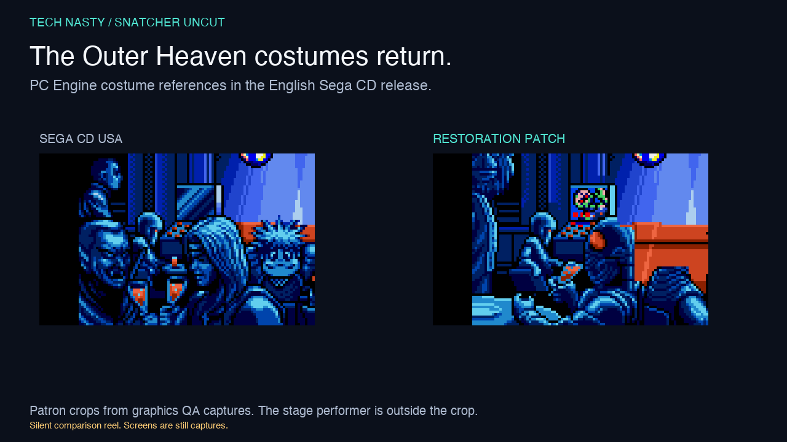

  

<h1 align="center">Snatcher for Sega CD, with the original cameos back</h1>

  The twitching dog guts are back. Lisa Nielsen's exposed breast is restored too. 
  The original costume cameos and selected dates return. 
  The original voice cast, music and expanded Act 3 stay. 
  Patch your own copy in your browser.

  <a href="https://github.com/t3chnaztea/snatcher-uncut-segacd/releases/download/v0.9.0-rc1/snatcher-uncut-player-v0.9.0-rc1.zip"><strong>Download the player patch</strong></a> 
  Free · v0.9.0-rc1 · 691 KB · You'll need your own USA disc dump 
  Tested on my U.S. Genesis Model 2 with a Mega EverDrive Pro.  
  <a href="#see-the-changes">See the changes</a> · <a href="https://github.com/t3chnaztea/snatcher-uncut-segacd/releases/download/v0.9.0-rc1/snatcher-uncut-media-v0.9.0-rc1.zip">Download the comparison kit</a>

## See the changes

### The Outer Heaven patrons return

The PC Engine costume cameos replace the Konami characters in the Sega CD bar. Their descriptions change too. The dancer and lighting stay as they were.

### Six restored costume views

The characters were captured at different points in their idle animations.

### The dates change on screen

Neo Kobe returns to 2042. The newspaper changes to 2039. The catastrophe caption changes to 1991. [Compare Moscow](media/assets/moscow-comparison.png) and [the newspaper](media/assets/newspaper-comparison.png).

### Watch the 42-second comparison

[Play the MP4](media/assets/release-reel.mp4) · [WebM version](media/assets/release-reel.webm). This silent reel uses comparison stills.

## Patch your copy

1. [Download the player ZIP](https://github.com/t3chnaztea/snatcher-uncut-segacd/releases/download/v0.9.0-rc1/snatcher-uncut-player-v0.9.0-rc1.zip). Extract the whole folder.
2. Open `browser/index.html`. Choose your original single BIN and CUE. Select **Verify and patch**.
3. Save the patched BIN and CUE together in a new folder. Open that CUE to play.

Your disc files stay on your computer. The installer checks the data track before and after patching. It keeps your audio and disc timing intact. No game or BIOS is included.

[Full instructions](INSTALL.md) · [Offline installer for split-track sets](OFFLINE-INSTALL.md). Keep your originals and back up your saves. Windows, Linux and mobile operation haven't been tested.

## Testing

Automated Genesis Plus GX tests reached the ending and credits. They covered required fights, transitions and a normal save followed by shutdown, fresh boot and loading from the game menu. Act 1 started from cold boot; the later tests continued from an Act 2 checkpoint. All 20 audio tracks and pregaps stayed byte-identical to the original dump.

[Verification and installer checks](VERIFICATION.md) · [Compatibility and known issues](KNOWN-ISSUES.md).

## Before you download

**How much is "Uncut"?** It restores selected artwork, cameos and dates. Some localized content stays. Adult ages remain 18. Optional menus and excluded age or sexualized-minor content are unchanged. The [changelog](CHANGELOG.md) lists the scope.

**Did you change the English script or voices?** Most of the English stays. Selected dates and cameo wording change. The opening and database say 1991 while the original speech says 1996. I kept the recordings unchanged.

**Did you use AI?** Yes. I used AI coding agents for research, code, automated testing and documentation. The restored art comes from the game data, not an image generator. The screenshots are emulator captures. [How it was made](AI-DISCLOSURE.md).

This is an unofficial fan patch with no Konami affiliation. [Credits and references](CREDITS.md) · [Rebuild from source](docs/setup.md) · [Report a bug](https://github.com/t3chnaztea/snatcher-uncut-segacd/issues).
